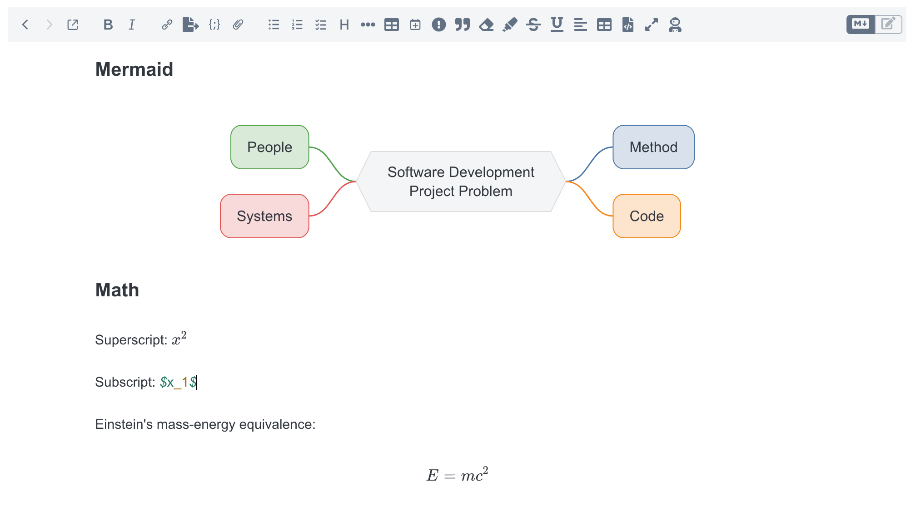

> [!note]
> This plugin is developed with AI assistance

# Enhanced Rendering

Render Mermaid diagrams (via [Pele](https://github.com/obsidianmd/pele)) and inline/block math (via [KaTeX](https://katex.org/)) directly in Joplin's CodeMirror 6 Markdown editor.



## Requirements

- Joplin 3.7 or newer
- Markdown editor using CodeMirror 6

## Installation

Install from Joplin's plugin manager, or install the `.jpl` file manually:

1. Download `com.bwat47.joplin-enhanced-rendering.jpl` from the latest release.
2. In Joplin, open `Tools > Options > Plugins`.
3. Select `Install from file`.
4. Restart Joplin if prompted.

## Notes

- This plugin changes editor display only. It does not modify note content.

- Math rendering requires "Enable math expressions (wysiwyg: yes)" to be enabled under Tools | Options | Markdown (otherwise the syntax tree nodes for math aren't available in the editor).

## Development

Requires Node 22 or later.

```bash
npm ci
npm test
npm run lint
npm run dist
```

Browser tests run the extension in a real CodeMirror editor using headless Chromium:

```bash
npx playwright install chromium
npm run test:browser
```

`npm run dist` creates the installable plugin at `publish/com.bwat47.joplin-enhanced-rendering.jpl`.
